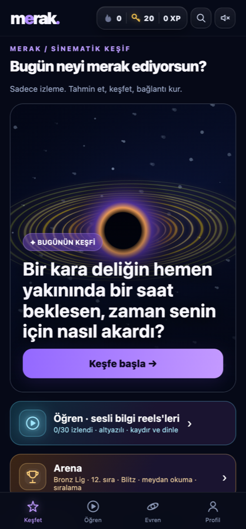
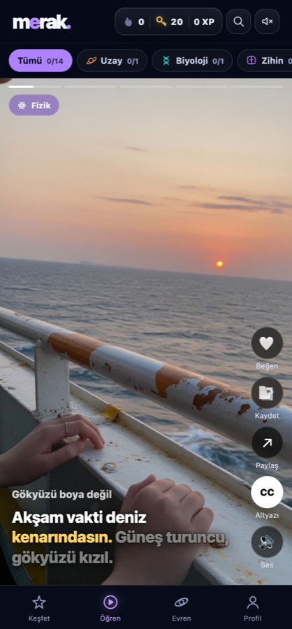

# merak.

**Merakını keşfe dönüştüren bilgi uygulaması**

[▶ Uygulamayı dene](https://merak-kesif.netlify.app)

---

MERAK; fizik, uzay, biyoloji, tarih, zihin ve teknoloji gibi alanlarda "bunu hiç düşünmemiştim" dedirten sorularla öğrenmeyi bir oyuna çeviren bir mobil web uygulaması. Sadece izlemiyorsun: tahmin ediyorsun, keşfediyorsun, bağlantı kuruyorsun.

  
  &nbsp;&nbsp;
  

## Öne çıkanlar

- **Günün keşfi**: her gün tek bir merak uyandıran soru, sinematik anlatımla
- **Sesli bilgi reels'leri**: kaydırıp dinlenen, kelime kelime altyazılı kısa anlatımlar
- **Merak Evreni**: her keşif bir yıldız doğurur; bilgi alanları galaksilere, konular gezegenlere dönüşür
- **Etkileşimli keşif görevleri**: gerçek bilimsel hikâyeleri dedektif gibi çözdüğün oyunlar
- **Arena ve ligler**: seri, XP ve meydan okumalarla rekabet
- **Defter tarzı animasyonlu bilim videoları**: yapay zekâ seslendirmeli kısa anlatımlar

## Durum

Aktif geliştirme aşamasında. Kaynak kod gizli tutulmaktadır.
